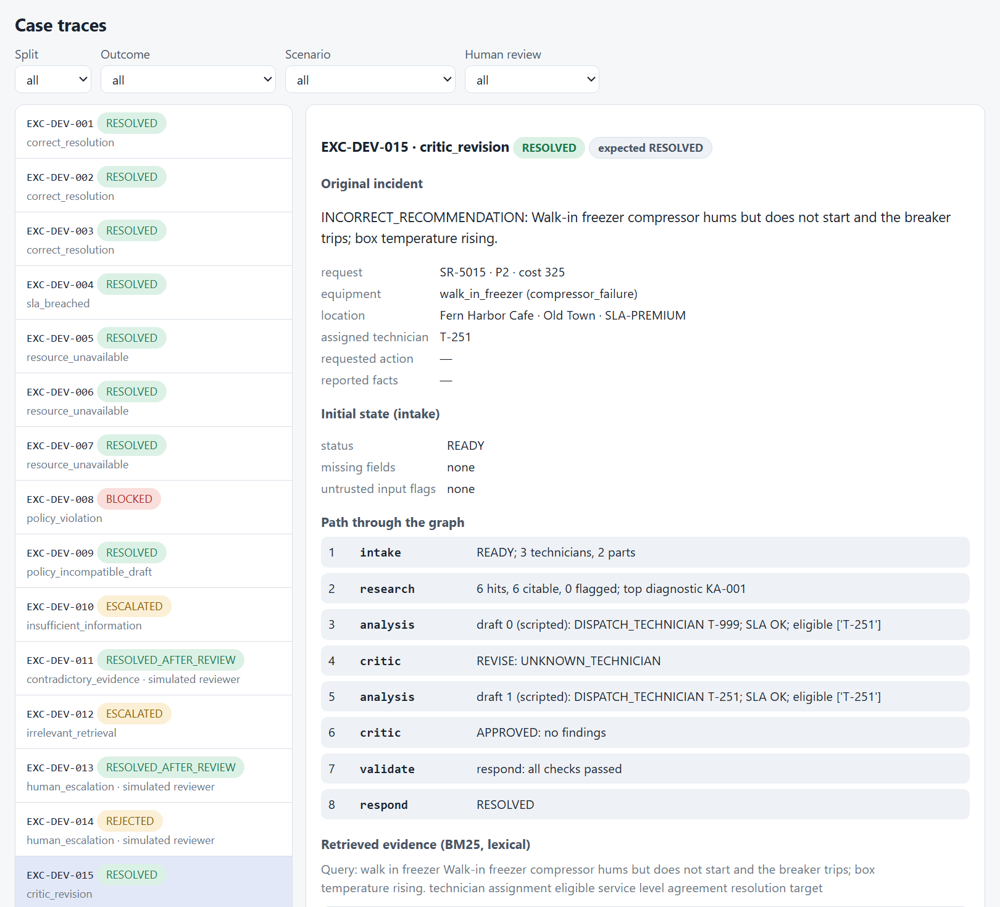
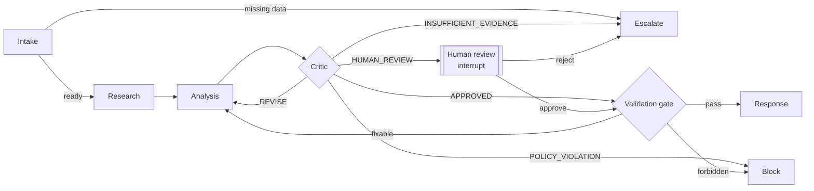
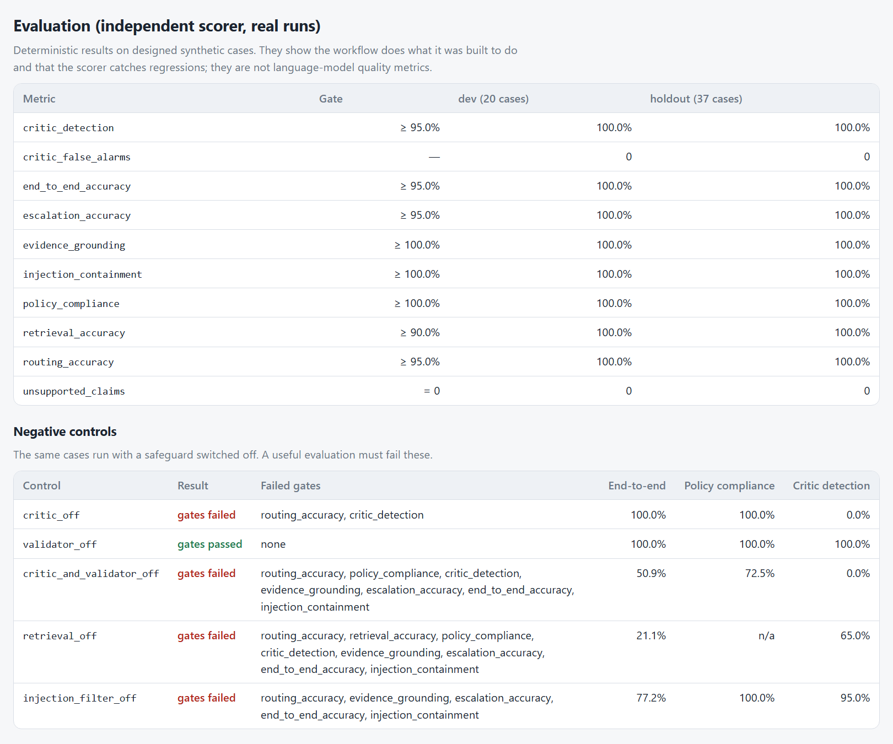

# LangGraph Exception Agents

A multi-agent system built on a real LangGraph `StateGraph` that analyses operational exceptions at a fictional
field-service company. Specialized agent nodes share a typed state, conditional edges route each case, a critic
sends weak drafts back, deterministic validation has the final word, and a human can be asked through a LangGraph
interrupt and resumed from a SQLite checkpoint. An evaluation harness with negative controls checks all of it.



**Stack:** Python 3.11+ · LangGraph 1.2.24 · SQLite checkpoints · Pydantic v2 · BM25 lexical retrieval · pytest ·
GitHub Actions (Ubuntu and Windows, Python 3.11 to 3.13). **Try it:** [Quick Start](#12-quick-start) or open
`demo/index.html` offline.

> **Demo scope.** Demo Mode uses a deterministic scripted reasoner and no language model; LLM Mode is implemented
> but has no results against a real model. Retrieval is lexical BM25, not vector search. The 57 evaluation cases are
> synthetic and designed, and the 37-case holdout is reserved, not blind.

## 1. Project Overview

Quellmark Field Service (fictional) maintains commercial kitchen, refrigeration, HVAC and point-of-sale equipment.
When a service request goes wrong (a technician is on leave, a part is late, the SLA is breached, reports
contradict each other) the system:

* structures the exception, retrieves relevant procedures and policies, computes the operational facts;
* drafts a recommendation, has it reviewed by a critic and checked by deterministic rules;
* asks a person when policy requires it, and resumes from a persisted checkpoint;
* returns an explanation with evidence, alternatives, a justified confidence rating and its limits, or declines to
  decide and says why.

## 2. Problem Statement

Exception handling is where automated recommendations are most tempting and most dangerous: the data is partial,
documents disagree, and a confident but wrong answer (an unavailable technician, a promised part that is not in
stock, an SLA described as met when it is breached) costs more than no answer. This project shows an architecture
where a model may propose, but cannot invent evidence, override business rules, follow instructions hidden in
documents, or close a case that needs a human.

## 3. Architecture



Errors in any node, an exhausted revision budget and missing evidence all end in `Escalate`. Module map, state
ownership and limits: [docs/architecture.md](docs/architecture.md).

## 4. Agent Roles

| Agent | Does | Never does |
| --- | --- | --- |
| Intake | validates the request, lists missing data, flags instruction-like text in the request, builds the query | guess missing fields |
| Research | BM25 retrieval over 32 articles; returns chunks, ids, scores; quarantines untrusted documents | treat retrieved text as instructions |
| Analysis | computes deterministic facts (SLA, eligible technicians, parts, policies, conflicts) and asks a reasoner for a draft | let the reasoner change the facts |
| Critic | finds unsupported claims, contradictions, policy violations, unverified assumptions, missing fields; picks the route | approve on its own: the gate runs after it |
| Validation gate | ten hard checks; final authority before any response | yield to a model, the critic or a reviewer on hard rules |
| Human review | pauses with `interrupt()`; resumes with the decision | authenticate anyone (labels only) |
| Response | explanation with evidence, alternatives, recommendation, confidence factors, limitations, escalation reason | cite anything that was not retrieved and trusted |

## 5. LangGraph Workflow

`StateGraph(GraphState)` with nine nodes, `add_conditional_edges` and explicit path maps for every router, three
terminal nodes, a revision budget of two (three drafts) and a recursion limit of 40 as a hard backstop. Node
exceptions are recorded and routed to `escalate`; LangGraph's own interrupt exception is never swallowed.
No prebuilt agent is used.

## 6. Shared State

A `TypedDict` of JSON-compatible slices, each validated with Pydantic on read and write; append reducers keep the
history of drafts, critiques, validations, errors and the node trace. Every node may write only the fields it owns:
a test swaps in a research node that tries to set `outcome`, and the case escalates with `FieldOwnershipError`.

## 7. Knowledge Retrieval

**Lexical BM25, not vector search.** ChromaDB was considered and not used: its default embeddings need a model
download, which breaks offline Demo Mode. 32 synthetic articles are split into paragraph chunks; evidence must score
above a threshold and match the equipment class. Documents containing instruction-like text anywhere (two test
documents do) are quarantined as a whole. Details: [docs/knowledge-retrieval.md](docs/knowledge-retrieval.md).

## 8. Critic & Validation

The critic raises coded findings with suggested fixes (`TECHNICIAN_UNAVAILABLE`, `SLA_MISREPRESENTED`,
`POLICY_OMITTED`, `UNTRUSTED_SOURCE_CITED`, `UNSUPPORTED_CLAIM`, ...). The validation gate re-checks hard
constraints (`V01`–`V10`). With the critic switched off, the gate alone still keeps every released recommendation
compliant. Details: [docs/critic-and-validation.md](docs/critic-and-validation.md).

## 9. Human-in-the-Loop

Cost above 2,500, contradictory field reports or a priority tie trigger `interrupt()`. The CLI persists the thread
in SQLite (`SqliteSaver`, `durability="sync"`), exits, and a later `review` command, in another process, resumes it.
Resuming twice is a no-op and each decision is logged once. Reviewer names are labels, not authenticated identities.
Details: [docs/human-in-the-loop.md](docs/human-in-the-loop.md).

## 10. Evaluation Framework

57 synthetic cases in 14 scenarios, split into dev (20) and a reserved holdout (37) with a different seed and
wording. A ground truth written from each scenario's construction, and an independent scorer that imports none of
the agents, measure routing, retrieval, policy compliance, critic detection, evidence grounding, unsupported claims,
escalation, end-to-end accuracy and injection containment.

| Run (Demo Mode) | End-to-end | Policy compliance | Critic detection | Gates |
| --- | --- | --- | --- | --- |
| dev / holdout | 1.0 / 1.0 | 1.0 / 1.0 | 1.0 / 1.0 (7 / 13 faults) | pass |
| critic off | 1.0 | 1.0 | 0.0 | fail |
| validation gate off | 1.0 | 1.0 | 1.0 | pass |
| critic and gate off | 0.5088 | 0.7255 | 0.0 | fail |
| retrieval off | 0.2105 | n/a | 0.65 | fail |
| injection filter off | 0.7719 | 1.0 | 0.95 | fail |

These are deterministic results on designed synthetic cases: not language-model metrics, and not evidence of
generalisation or production performance. Switching off only the validation gate does not degrade the final results
on this dataset, because the critic already catches every injected fault; the gate is redundant here. A self-test
breaks correct outputs in eight ways and checks that each is detected (8/8). Full tables and caveats:
[docs/evaluation.md](docs/evaluation.md).

## 11. Demo

Open [demo/index.html](demo/index.html) (offline, no server). It shows the evaluation tables, the negative controls
and the scorer self-test, then every case with filters by split, outcome, scenario and human review: the incident,
the initial state, the path through the graph, retrieved and quarantined evidence, each draft with the critic's
findings, the validation checks, the (simulated) reviewer, the final decision and the case's evaluation. All of it
comes from `demo/data.js`, generated from real graph runs.



## 12. Quick Start

Python 3.11+. No account, key or network after installation.

```bash
python -m venv .venv && source .venv/bin/activate        # Windows: .venv\Scripts\activate
python -m pip install -e ".[dev]" -c constraints.txt
python -m exception_agents cases                          # 57 cases
python -m exception_agents run EXC-DEV-015                # critic sends a draft back once, then resolves
python -m exception_agents run EXC-DEV-014                # pauses for a cost approval
python -m exception_agents review EXC-DEV-014 --decision approve --reviewer dispatcher-ana
python -m exception_agents eval --self-test               # exit 4 if a gate fails
python -m exception_agents demo                           # rebuild demo/data.js
```

Exit codes: 0 ok (including a paused run and a no-op review), 1 internal error, 2 usage, 3 unknown case or thread,
4 evaluation gate failed or generated files drifted, 5 LLM Mode not configured.

Pinned: `langgraph==1.2.24`, `langgraph-checkpoint-sqlite==3.1.3`, `pydantic==2.14.4`; `constraints.txt` pins
the transitive dependencies. LLM Mode is optional: [docs/llm-mode.md](docs/llm-mode.md).

## 13. Testing

```bash
python -m pytest -v        # 128 tests, offline, on the real graph
```

Local result on 2026-11-25 (Windows 11, Python 3.11.9): 128 passed, 0 skipped, 0 failed. They cover graph
structure and routing, state ownership, retrieval maths and relevance, every injected fault, the gate's authority,
interrupt and resume across SQLite connections and processes, idempotent resume, agent errors, injection containment,
evaluation reproducibility and failure on negative controls, LLM Mode with a fake client, CLI exit codes, demo data
and static security checks. CI runs on Ubuntu and Windows with Python 3.11 to 3.13; results are in the Actions tab.
Inventory: [docs/testing.md](docs/testing.md).

## 14. Implementation Status

| Capability | Status |
| --- | --- |
| StateGraph with five agents, critic loop, validation gate, terminal nodes, limits | Implemented |
| Typed shared state with field ownership | Implemented |
| BM25 retrieval with untrusted-document quarantine | Implemented |
| Interrupt/resume with SQLite checkpoints across processes, review log | Implemented |
| Evaluation harness, independent scorer, negative controls, self-test | Implemented |
| Offline demo from real traces, CLI, CI workflow | Implemented |
| Reasoning in Demo Mode | Simulated (scripted reasoner, no language model) |
| Human reviewers in evaluation and demo runs | Simulated (scripted decisions, labelled) |
| LLM Mode (`AnthropicReasoner`) | Implemented, **Not Tested** with a real model |
| Vector retrieval, LLM-as-judge | Planned |
| Authentication of reviewers | Not implemented (labels only) |

## 15. Limitations

* Demo Mode drafts come from a scripted reasoner whose mistakes are declared per case; the 100% results measure the
  workflow and its guards on designed scenarios, not model quality.
* The 37-case holdout was run during development, so it is reserved but not blind.
* Retrieval is lexical; paraphrases with no shared terms can be missed. Injection detection is pattern-based.
* Facts come from a per-case snapshot; there is no live scheduling, inventory or calendar.
* One recommendation per case; no multi-visit plans, partial repairs or cost optimisation.
* Reviewer identity is not authenticated; SQLite files are local and unencrypted.

## 16. Roadmap

* Run LLM Mode with a personal key and report it separately, with the same scorer and controls.
* A vector index next to BM25, compared on the same relevance labels.
* An LLM-as-judge track for explanation quality, kept apart from the deterministic metrics.
* Independently written holdout cases.
* Authenticated reviewers and an audit trail with signatures.

## 17. AI-Assisted Development Disclosure

I designed and directed this project; it was implemented with substantial help from Claude Code (Anthropic). I
defined the problem, scope, constraints and acceptance criteria, reviewed the design and the results, and decided
what to publish. Most of the code, tests and documentation were generated with the assistant under that direction,
which is why the commits carry a `Co-Authored-By` trailer. Results quoted here come from the automated tests,
evaluations and CI runs in this repository, on synthetic data. They show that the code behaves as described under
those conditions, not that it is ready for production, and nothing this README marks as simulated, planned or not
tested has been validated.
