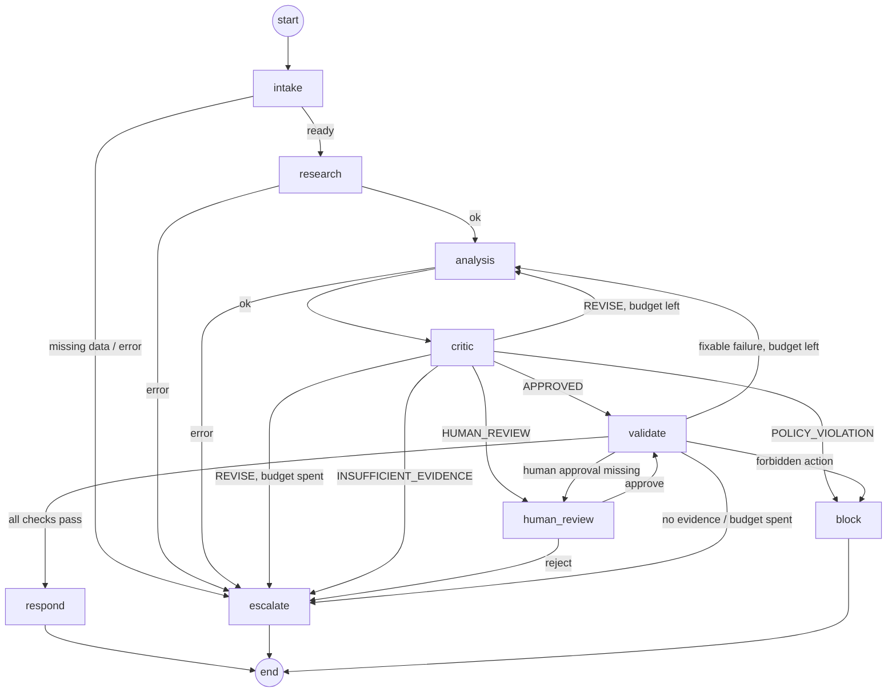

# Architecture

## Graph

Built in [`graph.py`](../exception_agents/graph.py) with `StateGraph`, `add_conditional_edges` and a path map for
every routing function. Terminal nodes: `respond`, `escalate`, `block`.

## Modules

| Module | Role |
| --- | --- |
| `agents.py` | The nine node functions and the negative-control switches |
| `graph.py` | State schema, field ownership guard, routing functions, graph assembly |
| `rules.py` | Deterministic facts: SLA, technician eligibility, parts, policies, conflicts, contradictions |
| `retrieval.py` | BM25 index, chunking, instruction-like text detection |
| `critic.py` | Critic findings and verdict |
| `validation.py` | Deterministic validation gate (final authority) |
| `response.py` | Final explanation, confidence rating, escalation and block outputs |
| `reasoners.py` | `ScriptedReasoner` (Demo Mode) and optional `AnthropicReasoner` (LLM Mode) |
| `runner.py` | In-memory and SQLite runs, interrupt handling, review log |
| `generator.py` | Synthetic cases and ground truth |
| `harness.py`, `evaluator.py` | Evaluation runs and the independent scorer |
| `demo.py`, `cli.py` | Demo data builder and command line |

## Shared state

`GraphState` is a `TypedDict`. Values are JSON-compatible dicts so SQLite checkpoints stay portable; each slice is
validated against a Pydantic model whenever a node reads or writes it.

| Field | Written by | Reducer |
| --- | --- | --- |
| `case` | input only | — |
| `intake` | intake | replace |
| `research` | research | replace |
| `analysis`, `draft` | analysis | replace |
| `drafts` | analysis | append (`operator.add`) |
| `critique` / `critiques` | critic | replace / append |
| `validation` / `validations` | validate | replace / append |
| `human_review` | human_review | replace |
| `final`, `outcome` | respond, escalate, block | replace |
| `errors`, `trace` | node wrapper | append |

**Field ownership.** `guarded()` wraps every node. An update with a key outside the node's entry in `NODE_WRITES`, a
value that fails its model, or an `outcome` that differs from `final.outcome` raises `FieldOwnershipError`; the
wrapper records it in `errors` and routing sends the case to `escalate`. A test replaces the research node with one
that tries to set `outcome`, and shows the case escalates instead.

## Limits and errors

| Mechanism | Value | Effect |
| --- | --- | --- |
| Revision budget | `max_revisions = 2` (3 drafts) | a draft still failing goes to `escalate` with `REVISION_LIMIT` |
| LangGraph recursion limit | 40 super-steps | hard backstop (`GraphRecursionError`) if routing ever loops |
| Node exceptions | any `Exception` except LangGraph's `GraphInterrupt` | recorded in `errors`, routed to `escalate` with `AGENT_ERROR` |
| Simulated failures | `simulation.fail_node` in a case | raises inside that node to exercise the error path |

## Determinism

No node reads the clock or a random source. `now` comes from the case, retrieval breaks ties by chunk id, and the
scripted reasoner is a pure function of the facts and the case's fault schedule. Two runs produce identical
states, which the tests and the `demo --check` drift check verify.
